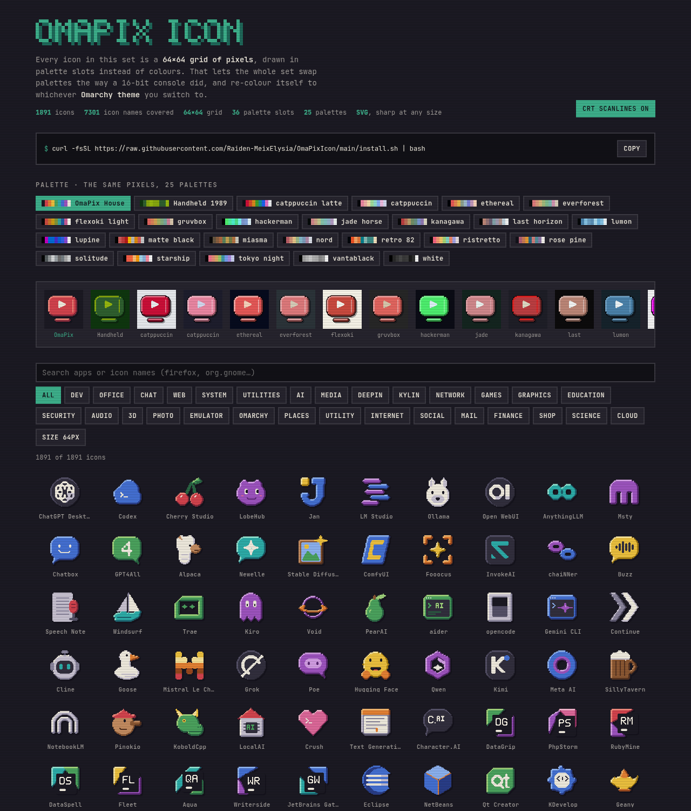
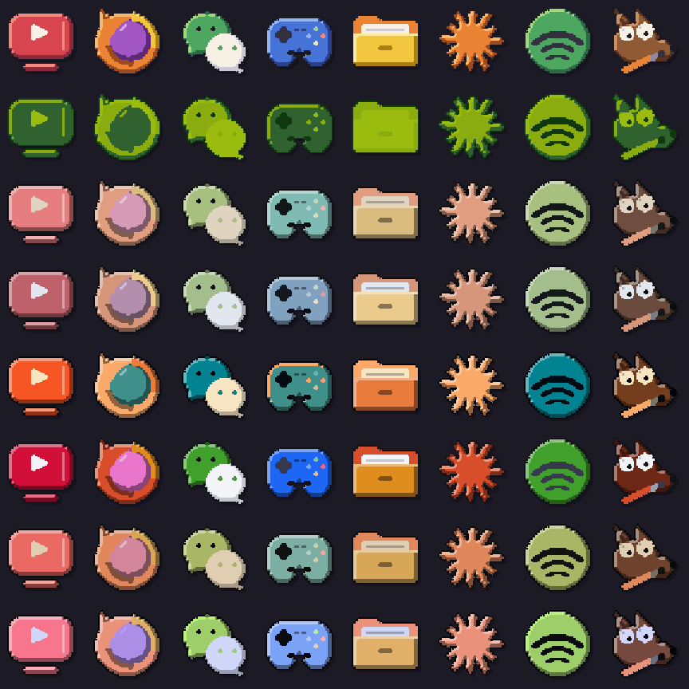
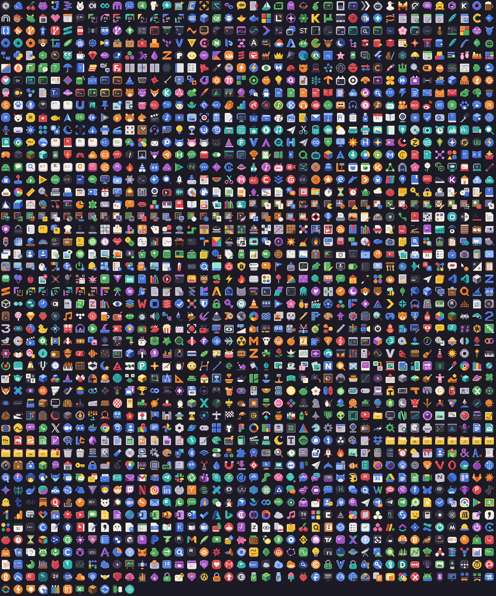

<p align="center"></p>

# OmaPixIcon

**[Open the live gallery →](https://raiden-meixelysia.github.io/OmaPixIcon/)** Browse all 1,910 icons, switch between 25 palettes and inspect each pixel.

<p align="center"><a href="https://raiden-meixelysia.github.io/OmaPixIcon/"></a></p>

A 16-bit pixel-art icon pack for [Omarchy](https://omarchy.org). Every icon is a
**64×64 high-resolution pixel sprite**, shipped as crisp SVG with an irregular silhouette (the object
itself, never a rounded-square tile), a single ink outline, top-left lighting and
a hard drop shadow, like a sprite from a 1993 cartridge.

Pixels are stored as **palette slots** (`R` red, `r` light red, `1` dark red, `K`
ink …) rather than RGB. The renderer maps those slots to a palette at install time,
so the set can be palette-swapped the way SNES sprites were. In **sync**
mode it re-colours itself to your Omarchy theme every time you switch themes.

<p align="center"></p>

## Install

OmaPixIcon ships inside [**OmaIcon**](https://github.com/Raiden-MeixElysia/OmaIcon), an icon pack switcher for the Omarchy bar. Install it, click the grid icon in the bar, and pick OmaPixIcon:

```bash
omarchy plugin add https://github.com/Raiden-MeixElysia/OmaIcon --enable
```

Or do it in one step. This installs OmaIcon, switches to OmaPixIcon, and re-points the few launchers that hard-code an icon *file path* to a themed icon name (reversible):

```bash
curl -fsSL https://raw.githubusercontent.com/Raiden-MeixElysia/OmaPixIcon/main/install.sh | bash
```

Uninstall, which also restores those launchers:

```bash
curl -fsSL https://raw.githubusercontent.com/Raiden-MeixElysia/OmaPixIcon/main/install.sh | bash -s -- --uninstall
```

Python 3 is the only dependency, and Omarchy already ships it. No ImageMagick, Inkscape or PIL needed.

## Request an icon

Missing a pixel icon for an app you use? Run this on your Omarchy machine:

```bash
curl -fsSL https://raw.githubusercontent.com/Raiden-MeixElysia/OmaPixIcon/main/tools/icon-request.sh | bash
```

It finds every app in your launcher that OmaPixIcon doesn't cover yet and saves `~/iconrequest.zip`. The zip contains each app's name, `Icon=` name, `.desktop` file, package or Flatpak id, and its current icon as a reference. It only reads your launchers and changes nothing on your system.

Then **[open an icon request →](https://github.com/Raiden-MeixElysia/OmaPixIcon/issues/new?template=icon-request.yml)** and drag `iconrequest.zip` into the form.

If you'd rather not run the script, open the request anyway and include:
- the app's name and where you got it (AUR, Flatpak, AppImage, web app)
- the `Icon=` line from its `.desktop` file (`grep ^Icon= ~/.local/share/applications/<app>.desktop /usr/share/applications/<app>.desktop`)
- a link to the official logo

## Palettes

| option | what you get |
|---|---|
| `--palette sync` *(default)* | Re-coloured to the active Omarchy theme, and again on every switch |
| `--palette house` | The hand-tuned OmaPix vintage palette |
| `--palette dmg` | Four shades of 1989 handheld green |
| `--palette nord`, `gruvbox`, `tokyo-night`, … | Pinned to any of the 23 built-in Omarchy theme palettes |

Pick one in the panel, or pass it to the installer:

```bash
curl -fsSL https://raw.githubusercontent.com/Raiden-MeixElysia/OmaPixIcon/main/install.sh | bash -s -- --palette house
```

## What's covered

Every application that ships with Omarchy 4.5 (Hype, Monologue, Gliff, Signed,
Omasnap, Omacut, Omawrite, Aether, the default web apps, LibreOffice …), plus
about 1,900 icons in total (7,300+ icon names): the most-used Linux apps across browsers, chat, dev tools,
terminals, media, graphics, games and system utilities, plus a pixel *places*
set (folders, home, trash, drives), Chinese apps (WeChat, QQ, Feishu/Lark, DingTalk, WPS, Bilibili, Kimi, Doubao, the deepin/UOS suite …), AI desktops (Claude, ChatGPT, DeepSeek, Cherry Studio, LM Studio, Ollama …), and the KDE, GNOME, XFCE and elementary catalogues. Anything not
covered falls back to your Omarchy Yaru variant.

<p align="center"></p>

## How it's made

```
icons/*.py        icon sources: drawing code on a 32×32 canvas (primitives + ASCII sprites)
engine/pix.py     pixel engine: shapes, pixel fonts, auto-outline, bevel lighting, centring, checks
build.py          compiles sources → data/icons.json (palette-indexed pixels) + gallery data
engine/render.py  pure-stdlib PNG/SVG writer + palette mapping (house / dmg / any colors.toml)
install.sh        one-click installer: adds OmaIcon and switches to OmaPixIcon
STYLE.md          the rules every icon follows
```

`build.py` enforces the style mechanically: the silhouette's long side must be 26–28 px,
the outline must be closed, and an icon may use at most 12 palette slots. That's why the
whole set reads as one family at the same visual size.

### Add or tweak an icon

```python
# icons/mine.py
from pix import icon

@icon('my-app', ['com.example.MyApp'], 'dev', 'My App')
def my_app(c):
    c.circle(16, 16, 12, 'B')
    c.text(12, 12, 'M', 'W')
    c.bevel(['B'])
    c.outline()
```

```bash
./build.py --only icons/mine.py --sheet /tmp/mine.png   # preview
./build.py                                               # rebuild data/icons.json
```

OmaIcon ships a pinned copy of the pack. After a release here, run `tools/sync-pack.sh ../OmaPixIcon` in an OmaIcon checkout.

## License

[MIT](LICENSE), for both the code and the artwork. Brand icons are pixel reinterpretations of
trademarks that belong to their owners, included for identification in the
spirit of other freedesktop icon themes.
